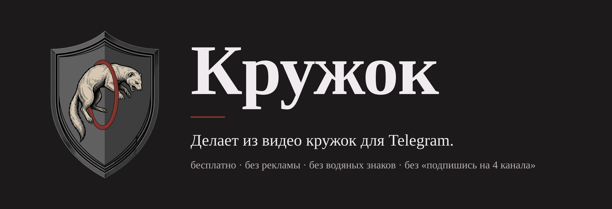
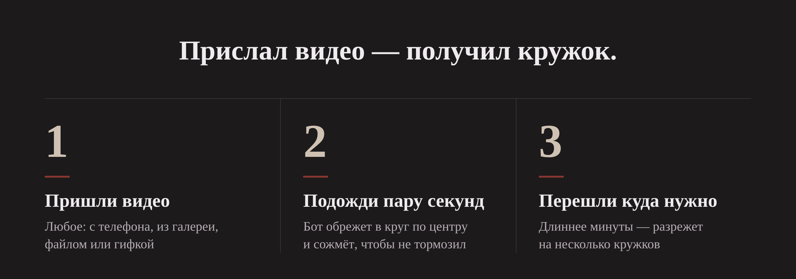
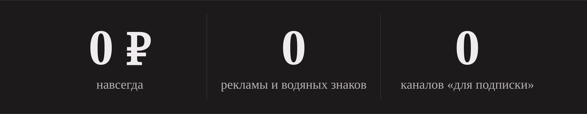
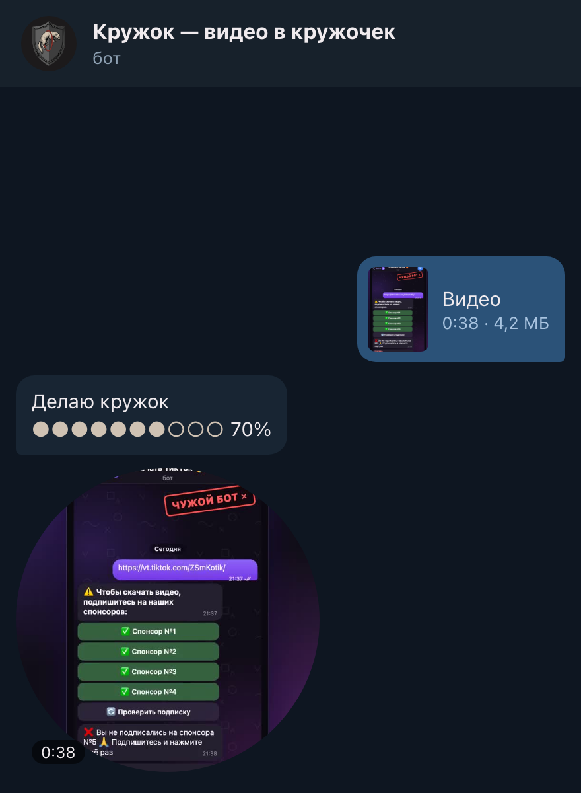

<p align="center">
  
</p>

<p align="center">
  <a href="https://t.me/chisto_krugi_bot"></a>
  <a href="https://github.com/kozliq/krugi/actions/workflows/ci.yml"></a>
  
  <a href="LICENSE"></a>
</p>

<h3 align="center">Прислал видео — получил кружок.</h3>

<p align="center">
  Без рекламы, водяных знаков, регистрации и «подпишись на 4 канала, чтобы продолжить». Бесплатно.
</p>

<p align="center">
  <a href="https://t.me/chisto_krugi_bot"><b>Открыть бота: @chisto_krugi_bot</b></a>
  &nbsp;·&nbsp;
  <a href="#что-умеет">Что умеет</a>
  &nbsp;·&nbsp;
  <a href="#свой-сервер">Свой сервер</a>
  &nbsp;·&nbsp;
  <a href="#поддержать">Поддержать</a>
</p>

<br>

<p align="center">
  
</p>

<p align="center">
  
</p>

## Что умеет



- **Обрезает в круг по центру** — с учётом того, как держали телефон.
- **Сжимает под Telegram**: до 640×640, H.264, около 1,5 Мбит/с — кружок не тормозит и быстро уходит.
- **Длиннее минуты** — предлагает разрезать на кружки по минуте (до десяти) или взять одну минуту.
- **Нужен не тот кусок** — подпиши видео временем, например `1:20`, кружок начнётся оттуда.
- **Видео, файл или гифка** — MP4, MOV, WEBM, MKV, AVI, GIF.
- **Закрыты видеосообщения** в настройках — пришлёт обычным видео и скажет, где открыть.
- **Отправить от себя**: Переслать → выбрать чат → нажать на пересылаемое → «Скрыть имя отправителя».

<br clear="right">

## Почему этому можно доверять

- **Видео не хранится.** Сделал кружок — удалил и исходник, и результат. Журналов просмотров нет; в статистике только число кружков и число людей (номера — хешем).
- **Ничего лишнего не просит**: ни подписок, ни номера, ни доступа к чатам. В личке работает, в группах молчит.
- **Чужой файл не опасен для сервера.** FFmpeg открывает только обычные видеоконтейнеры и только с диска: «видео», которое на деле плейлист со ссылками на чужие файлы, не откроется. На каждое видео — таймаут, на всё вместе — потолок процессора и памяти.
- **Весь код открыт** — два файла, только стандартная библиотека Python и FFmpeg.

## Ограничения, честно

- Обычный Telegram отдаёт ботам присланные файлы **только до 20 МБ**. Видео больше — бот попросит обрезать или сжать. С собственным сервером Telegram (`telegram-bot-api --local`) — до 2 ГБ.
- Кружок — **до минуты**, так устроен Telegram. Длинное видео — несколько кружков.
- Не больше 40 кружков в час и 150 в день на человека, у одного человека до трёх видео в очереди: сервер один, всем должно хватить.

## Свой сервер

Нужны Python 3.9+ и FFmpeg. Зависимостей нет.

```sh
git clone https://github.com/kozliq/krugi && cd krugi
mkdir -p ~/.krugi && echo "ТОКЕН_ОТ_BOTFATHER" > ~/.krugi/bot.token
KRUGI_DATA=~/.krugi KRUGI_WORK=/tmp/krugi python3 krugi.py
```

Для Linux-сервера — готовая служба systemd с клеткой и потолками: [`deploy/krugi-bot.service`](deploy/krugi-bot.service).

| Переменная | Что делает | По умолчанию |
|---|---|---|
| `KRUGI_TOKEN` | токен бота (или файл `bot.token` в `KRUGI_DATA`) | — |
| `KRUGI_DATA` | папка для `bot.token`, статистики и донатов | `~/Library/Application Support/Krugi` |
| `KRUGI_WORK` | временные файлы видео | `~/Library/Caches/Krugi` |
| `KRUGI_TG_API` | адрес Bot API (свой сервер Telegram) | `https://api.telegram.org` |
| `KRUGI_TG_LOCAL` | `1` — свой сервер в режиме `--local`, видео до 2 ГБ | — |
| `KRUGI_JOBS` | сколько видео обрабатывать разом | `2` |
| `KRUGI_FFMPEG_THREADS` | потоков FFmpeg на одно видео | `2` |

Аватарка: `python3 krugi.py avatar brand/avatar-640.jpg`. Имя, описание и команды бот ставит себе сам при запуске.

## Тесты

```sh
python3 -m unittest discover -s tests
```

44 теста: обработка (обрезка по центру, поворот телефона, 60 fps, WEBM и GIF, разрезка, битые файлы, плейлист-ловушка, зависший FFmpeg) и бот целиком на поддельном Telegram — от «прислал видео» до «пришёл кружок», в обычном режиме и со своим сервером Telegram.

## Поддержать

Бот бесплатный и таким останется. Сказать спасибо можно звёздочкой — командой `/donate` в боте. Это добровольно и ни на что не влияет; передумал — `/paysupport`, звёзды вернутся.

## Ещё от нас

- [**Чисто**](https://github.com/kozliq/chisto) — убирает рекламу и слежку на телефоне и компьютере.
- [**Качалка**](https://github.com/kozliq/kachalka) — сохраняет видео из YouTube, TikTok и VK без водяных знаков.

Лицензия — [MIT](LICENSE).
